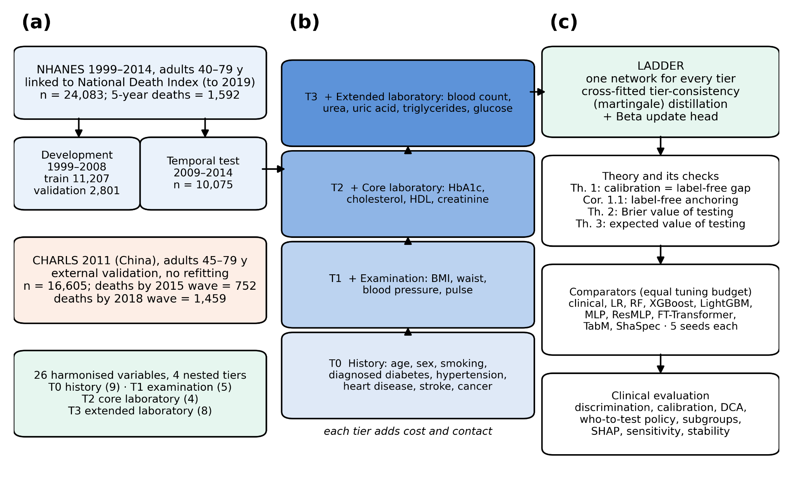
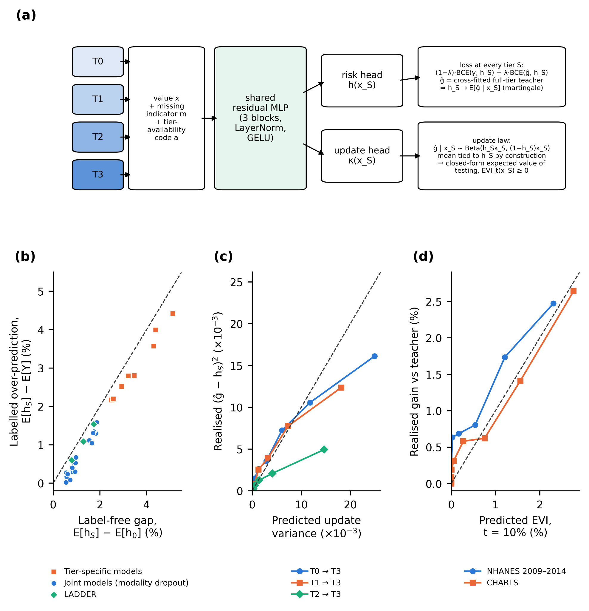
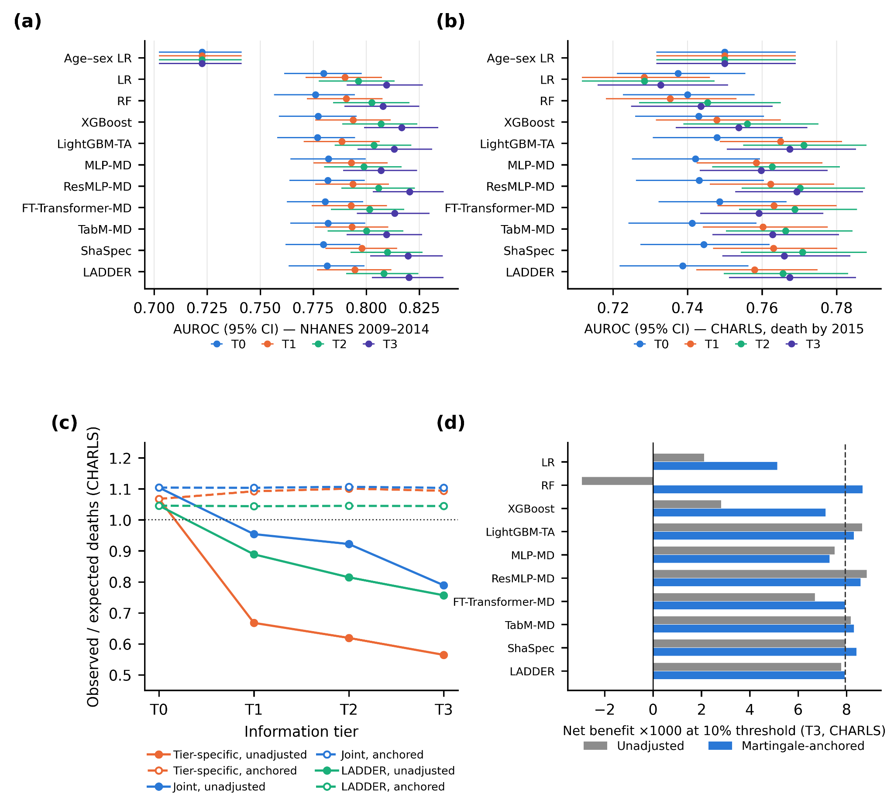

# LADDER

### Tier-consistent multimodal estimation of five-year mortality risk across clinical information tiers

LADDER is a multimodal risk-prediction framework that treats clinical information as a sequence of nested tiers: history, physical examination, initial laboratory measurements, and extended laboratory measurements. It enforces a martingale relation between risks estimated at successive tiers and uses that relation to audit and correct calibration in a new population without requiring new outcome labels.

> This public repository contains a research overview and selected aggregate figures only. Source code, participant-level data, detailed tables, model artifacts, and manuscript files are maintained privately.

## Research problem

Clinical mortality risk is estimated incrementally, while many prediction models assume that every input is already available. Separately fitting a model for each information tier can produce risks that disagree as new tests arrive and can become severely miscalibrated when transported to another health system.

This study asks whether one model can:

1. provide coherent five-year mortality estimates at every stage of information acquisition;
2. detect tier-specific calibration failure in a new population without outcome labels;
3. correct laboratory-induced miscalibration through label-free anchoring; and
4. estimate which patients are most likely to benefit from additional testing.

## Study design

  

<em>Development, temporal testing, external validation, nested information tiers, and the evaluation framework.</em>

### Information tiers

| Tier | Information available |
|---|---|
| T0 | Demographics and medical history |
| T1 | T0 plus physical examination and vital signs |
| T2 | T1 plus initial laboratory measurements |
| T3 | T2 plus extended laboratory measurements |

### Cohorts

| Cohort | Role | Participants | Mortality information |
|---|---|---:|---|
| NHANES 1999–2008 | Development | 14,008 | 1,016 five-year deaths (7.3%) |
| NHANES 2009–2014 | Temporal test | 10,075 | 576 five-year deaths (5.7%) |
| CHARLS 2011 | Cross-national external validation | 16,605 | 752 deaths by the 2015 wave (4.8%) |

## Martingale framework

Let \(\mathcal{F}_S\) denote the information available at tier \(S\), and let \(\hat g\) be the full-tier risk. LADDER requires the tier-specific risks to satisfy

$$
h_S = \mathbb{E}[\hat g \mid \mathcal{F}_S].
$$

This condition means that the risk before testing should equal the expected risk after observing the additional tier. The framework yields:

- a label-free identity for reduced-tier calibration;
- a decomposition of Brier improvement from testing;
- a closed-form, non-negative expected value of information (EVI);
- an optimal EVI ranking under a fixed testing budget; and
- label-free martingale anchoring for correcting tier-specific calibration shift.

## LADDER architecture

LADDER uses a shared residual multilayer perceptron across all four tiers. Each predictor is represented with its standardized value, missingness indicator, and tier-availability code. A risk head estimates \(h_S\), while a Beta update head models the distribution of the full-tier risk conditional on the current tier.

Training combines observed-outcome supervision with **five-fold cross-fitted martingale distillation** from out-of-fold full-tier risks. Cross-fitting prevents the teacher from leaking in-sample targets into the reduced-tier objectives.

  

<em>Shared tier-aware network, theoretical checks, label-free calibration audit, and expected value of testing.</em>

## Evaluation

LADDER was compared with ten models under equal tuning budgets and five random seeds. Comparators included age–sex logistic regression, tier-specific regression and tree models, tier-augmented LightGBM, modality-dropout neural networks, FT-Transformer, TabM, and ShaSpec.

The prespecified primary endpoints were tier-averaged AUROC and Brier score in temporal testing. Additional analyses evaluated tier-specific discrimination, calibration, observed-to-expected ratios, decision curves, cross-national transport, theoretical identities, testing policies, ablations, subgroups, and robustness.

## Main results

| Result | LADDER |
|---|---:|
| Temporal-test AUROC at T1 | 0.795 (95% CI 0.777–0.812) |
| Temporal-test AUROC at T3 | **0.820** (95% CI 0.803–0.836) |
| External CHARLS AUROC at T3 | **0.767** (95% CI 0.751–0.785) |
| External T3 O/E before anchoring | 0.757 |
| External T3 O/E after label-free anchoring | **1.045** |

LADDER exceeded four comparators in tier-averaged discrimination after Holm correction, but did not outperform XGBoost, a residual MLP, or ShaSpec. Its main contribution was therefore tier consistency and label-free calibration monitoring rather than superior discrimination.

## Label-free calibration audit and anchoring

In CHARLS, separately refitted tier-specific models systematically overpredicted mortality after laboratory information was added. Their full-tier observed-to-expected ratios ranged from 0.519 to 0.629.

A gap computed without outcome labels tracked the external calibration error across model–tier combinations with **r = 0.994**. Martingale anchoring then shifted tier logits using the transported history-tier risk and restored full-tier O/E ratios to **1.045–1.149** across all evaluated models.

  

<em>Discrimination by information tier, external calibration before and after anchoring, and decision-curve results.</em>

## What the study found

- Discrimination generally increased as clinical information accumulated.
- LADDER matched the strongest comparators but did not establish superior discrimination.
- External transport mainly damaged absolute-risk calibration rather than rank discrimination.
- The label-free martingale gap identified laboratory-induced calibration failure before using external outcomes.
- Label-free anchoring restored calibration across all evaluated model families.
- The proposed expected-value-of-testing policy did not consistently outperform a simpler uncertainty-band heuristic.

## Limitations

- Label-free anchoring assumes that the history-tier risk transports adequately to the target population.
- It cannot correct secular shifts that affect every tier, including the baseline history tier.
- CHARLS mortality was recorded by survey wave rather than an exact dated endpoint.
- Some laboratory tiers were unavailable as complete blocks in the external cohort.
- The proposed network did not improve discrimination over the strongest baselines.
- Clinical usefulness requires prospective evaluation and prespecified testing costs and thresholds.

## Data and code availability

NHANES and CHARLS were used under their respective public data-access conditions. Participant-level data are not redistributed. Source code, full tables, model outputs, and manuscript materials remain in private repositories while the study is under review and development.

## Disclaimer

This repository presents retrospective methodological research and does not provide a clinical risk calculator or test-ordering tool.
